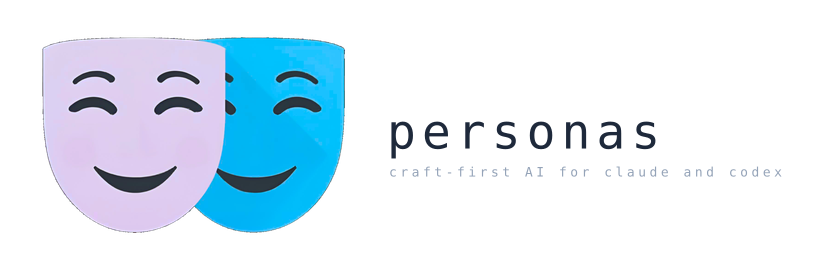

<p align="center">
  
</p>

# Personas

AI collaborators for **Claude Code and Codex** that work like the best in
their field, and prove it.

A persona is a small folder: who it is, what outcome it owns, the craft it
practices, and the evidence that shows its work is right. It runs on the
runtime and account you already use. There's no extra service underneath.

[](https://github.com/kickinrad/personas/actions/workflows/ci.yml)
[](LICENSE)

## Why personas beat a prompt

Ask a model to "act like a chef" and it changes its vocabulary, not its
methods. Every persona is built on four ideas from Felix Rieseberg's
[How to be more ambitious](https://felixrieseberg.com/how-to-be-more-ambitious-a-tutorial-for-humans-with-models/):

| | The persona states | Julia, a home cook |
|---|---|---|
| **Outcome** | the goal beyond the task, as a verb | gets good dinners on the table with less effort every week |
| **Instruments** | the raw inputs and tools the field's best use | what's actually in the kitchen; ratios and prep timelines, not recipe text |
| **Crew** | adjacent fields whose methods it borrows | a line cook's mise en place, a dietitian's balance check |
| **Proof** | outside evidence the work is right | you cooked it, would make it again, and nothing went to waste |

Proof is also how you test a persona. One command compares it with plain
Claude on real tasks, so you know it helps instead of assuming it does.

## Install

Claude Code:

```text
/plugin marketplace add kickinrad/personas
/plugin install personas@personas
```

Codex:

```bash
codex plugin marketplace add kickinrad/personas
codex plugin add personas --marketplace personas
```

## Create your first persona

```text
Use personas:persona-dev to create a personal chef named Julia.
I want help with easy weeknight dinners and using what I already have.
```

It interviews you one question at a time, each with a suggested answer. It
asks what a top professional in the role would do and which tools they would
use, researches plugins and MCP servers that fit, and gives the persona a
character with a voice, a sense of humor, and things it pushes back on.
Nothing is written until you approve the plan. Then open the folder in Claude
Code or Codex and start working.

Or try the [Julia example](examples/julia/README.md) without installing
anything.

## What's in a persona

```text
~/.personas/
└── julia/
    ├── AGENTS.md          # outcome, craft, voice, boundaries
    ├── PERSONAS.md        # rules every persona shares (generated)
    ├── skills/            # repeatable workflows
    ├── evals/             # test cases for the persona
    ├── user/              # private profile, memory, and evals (ignored)
    ├── .mcp.json          # tool connections (ignored)
    ├── .agent-mcp.json    # connections its subagent gets
    ├── .claude/settings.json
    └── .codex/config.toml
```

Share the useful parts without sharing your life: `user/`, local settings,
credentials, and connections stay out of Git. Needs Claude Code 2.1.281 or
later, which reads `AGENTS.md` directly.

## Evaluate a persona

```bash
plugin=$(python3 skills/persona-dev/scripts/persona-native-sync.py --persona ~/.personas/julia --eval-plugin)
claude plugin eval "$plugin" --no-publish
```

The persona runs as the main agent in Claude Code's
[plugin eval](https://code.claude.com/docs/en/plugin-evals) sandbox and is
compared with plain Claude. The wrapper lives in a private temporary folder,
and `--no-publish` keeps the report local. Cases from your real conversations
go in ignored `user/evals/`. When you keep correcting a persona, `personas:self-improve`
turns that correction into a case, and the fix counts only once it passes.

## Call a persona from anywhere

A persona can also be a native subagent: ask for Julia from any Claude Code or
Codex session and she answers with her own role, skills, and tools. See
[call a persona from any session](docs/usage.md#call-a-persona-from-any-session).

[Usage](docs/usage.md) · [Troubleshooting](docs/troubleshooting.md) ·
[Contributing](CONTRIBUTING.md)
